# NEXA

  

<h1 align="center">NEXA</h1>

  <b>现代、轻量的跨平台代理客户端 · Windows / macOS / Android</b> 
  Go + Wails v2 + sing-box 内核 · 玻璃拟态界面 · 日/夜双主题 · 规则/全局分流

  
  
  
  
  

  <b>平台:</b> 🪟 <a href="#-下载安装--windows">Windows 2.x</a> &nbsp;·&nbsp; 🍎 <a href="../../releases/tag/mac-v1.3.0">macOS 1.x</a> &nbsp;·&nbsp; 🤖 <a href="#-android-版本31x-独立版号线">Android 3.x</a>

---

## ✨ 界面预览 · Windows

**首页 · 夜间主题**

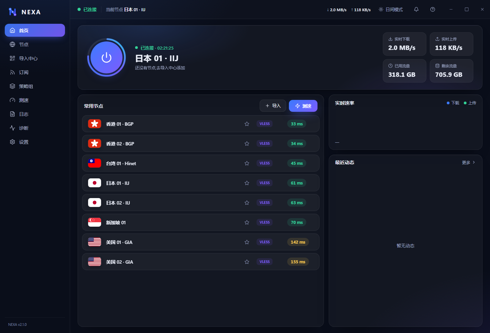

**首页 · 日间主题**(一键切换,自动记忆)

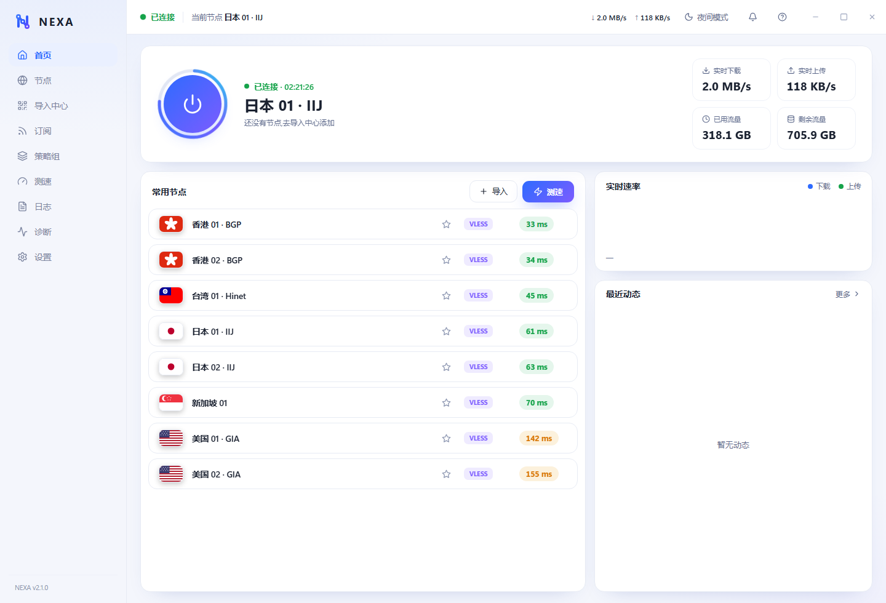

**节点管理**

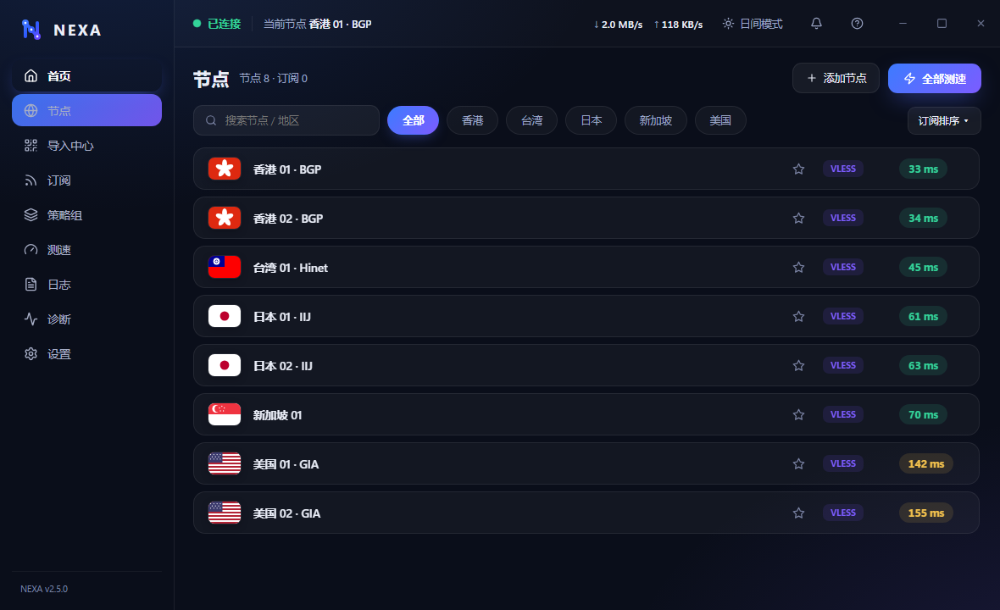

**策略组 · 手动 / 自动选择**

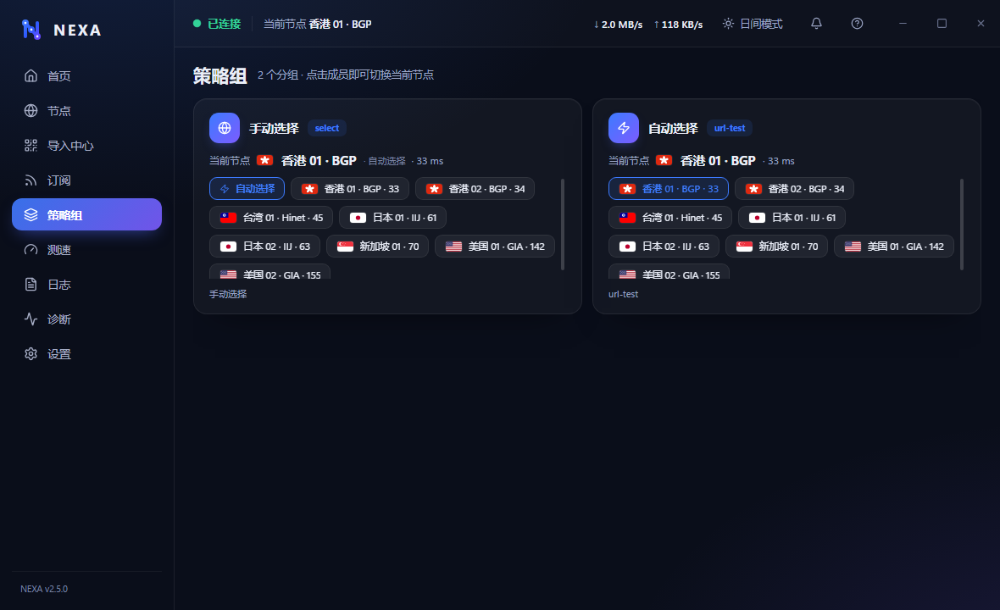

**导入中心**

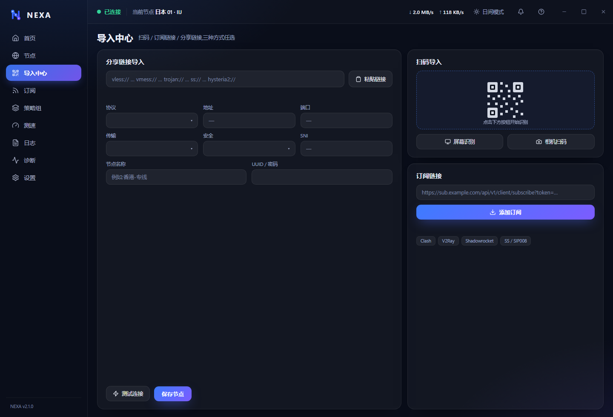

**设置中心**

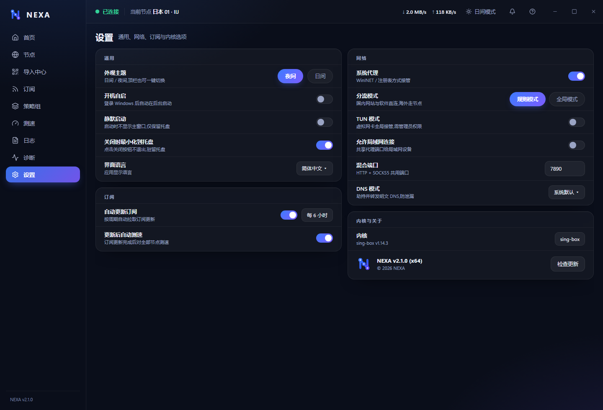

## 📥 下载安装 · Windows

前往 [**Releases**](../../releases) 页面下载最新版 `NEXA-amd64-installer.exe`:

1. 双击运行安装包(需要管理员权限)
2. 安装程序自动检测系统是否已安装 **WebView2 运行时**,缺失时自动下载安装
3. 安装完成,桌面与开始菜单自动创建 **NEXA** 快捷方式
4. 首次启动后,在「导入中心」导入订阅或节点即可使用

> 安装包体积约 8 MB。内核(sing-box)在首次连接时自动下载,无需手动操作。

## 📖 使用说明 · Windows

### 第 1 步 · 导入节点

打开「导入中心」,三种方式任选:

- **订阅链接**:粘贴机场订阅地址(自动识别 Clash YAML / V2Ray base64),点击「添加订阅」
- **分享链接**:粘贴 `vless://`、`vmess://`、`trojan://`、`ss://`、`hysteria2://` 链接,表单自动回填,可保存前先测连通
- **扫码导入**:屏幕识别二维码(支持多屏多码)或相机扫码

订阅添加后可设置**自动更新周期**(1-24 小时)与「更新后自动测速」。

### 第 2 步 · 连接

回到首页,点击电源按钮即可连接:

- 默认「**自动选择**」模式:内核自动测速,始终使用延迟最低的节点;也可点击任意节点固定使用(手动模式)
- 顶栏实时显示连接状态、当前节点、实时上下行速率
- 首页「节点列表」按订阅顺序展示全部节点,点 ⭐ 收藏常用节点
- 右侧「实时速率」绘制流量曲线,「最近日志」滚动展示运行事件

### 第 3 步 · 选择分流模式

在「设置 → 网络 → 分流模式」或**系统托盘右键菜单**中选择:

- **规则模式(默认)**:国内网站与软件直连,海外流量自动走节点(内置 GeoIP/GeoSite 规则集)
- **全局模式**:全部流量走节点

连接状态下切换即时生效,无需断开重连。

### 第 4 步 · 测速与切换节点

- 「节点」页或首页点击「⚡ 测速」:并发检测全部节点真实延迟(HTTP 模式,未连接时自动退化为 TCP 握手)
- 节点页支持三种排序:**订阅排序**(默认,与机场订阅一致)/ 延迟优先 / 名称排序
- 点击任意节点行即可切换,连接状态下即时生效
- 「策略组」页:**手动选择**(select)与**自动选择**(url-test)两组——自动模式由内核测速自动切换最低延迟节点,手动模式点成员即固定;选择会自动记忆,重启后保持

### 第 5 步 · 日常使用

- **系统托盘**:左键点击图标直接唤起主窗口;右键弹出菜单(打开 / 连接断开 / **规则模式 / 全局模式** / 开机自启 / 退出);托盘图标颜色随连接状态变化(彩色 = 已连接)
- **关闭最小化**:关闭窗口可驻留托盘后台运行(设置中可调整)
- **诊断页**:一键自检网络连接、系统代理、TUN、DNS 解析、DNS 泄漏、内核状态

### 第 6 步 · 进阶设置(设置页)

- **混合端口**:HTTP + SOCKS5 共用端口(默认 7890,可修改)
- **允许局域网连接**:共享代理端口给局域网设备
- **TUN 模式**:虚拟网卡全局接管,无需系统代理(需管理员权限运行)
- **DNS 模式**:DoH 加密解析(1.1.1.1 / 8.8.8.8)防泄漏,或系统默认
- **内核日志**:详细(记录每条连接,排查用)/ 简洁(仅警告与错误)
- **域名白名单**:代理白名单(内置 `www.nodeseek.com`,名单内网址任何模式下都走代理)+ 直连白名单(任何模式下都直连),按行填写自动包含子域名

## 🚀 功能特性

| 模块 | 说明 |
| --- | --- |
| 🖥 连接控制 | sing-box 内核管理,实时速率曲线,连接状态托盘联动 |
| 🌏 分流模式 | 规则模式(内置 GeoIP/GeoSite)+ 全局模式,设置页 / 托盘菜单随时热切换 |
| 📶 订阅管理 | 自动识别格式、流量与到期显示、定时更新、更新后自动测速 |
| 🔍 多种导入 | 链接解析、订阅、屏幕扫码、相机扫码 |
| 🚀 节点与策略组 | 地区识别 + 国旗、收藏、订阅排序/延迟/名称三种排序、真实延迟测速、手动/自动(url-test)选择组、实时切换 |
| 🧭 域名白名单 | 代理白名单(内置 nodeseek)+ 直连白名单,任何模式下强制生效 |
| 🛡 TUN 模式 | 虚拟网卡全局接管,应用崩溃内核随之退出,不留残留进程 |
| 🧩 系统集成 | 托盘、开机自启、关闭驻留、窗口状态记忆、单实例 |
| 🌗 双主题 | 极光夜 / 日间模式,即时切换持久化 |
| 🧹 自动维护 | 日志自动轮转清理、内核一键下载更新、WebView2 自检、退出自动还原系统代理 |

## ⚙️ 系统要求 · Windows

| 项目 | 要求 |
| --- | --- |
| 操作系统 | Windows 10(1803+) / Windows 11 |
| 运行时 | WebView2 Runtime(安装包自动检测并安装) |
| 内核 | sing-box(自动下载,支持一键更新) |
| TUN 模式 | 需以管理员身份运行 |

## ❓ 常见问题

**Q: 安装或运行时杀毒软件提示风险?**
未签名的独立软件可能被部分杀毒引擎启发式误报。本软件不包含任何恶意行为,可选择信任放行;有条件的话建议对发行包进行代码签名。

**Q: 退出或异常结束后浏览器无法上网?**
NEXA 在正常退出、异常崩溃后都会自动还原系统代理;若检测到残留会于下次启动自动清除。如仍遇问题,检查 Windows「设置 → 网络 → 代理」是否残留手动代理并关闭。

**Q: 与其他代理工具冲突?**
控制端口自动避开 9090 等常用端口;混合端口默认 7890,如被占用请在「设置 → 网络」中修改。

**Q: 连接后如何确认在走节点?**
「日志」页可查看每条连接的进出明细;「诊断」页一键自检全链路状态。

## 📱 Android 版(v3.1.x · 独立版号线)

与桌面同源的「极光夜」设计体系与 sing-box 1.14 内核,**进程内运行,免 root**。版号线独立(Android 3.x),与 Windows 2.x / macOS 1.x 互不干扰。

  
  
  
  

**首页 · 日间主题(已连接)**

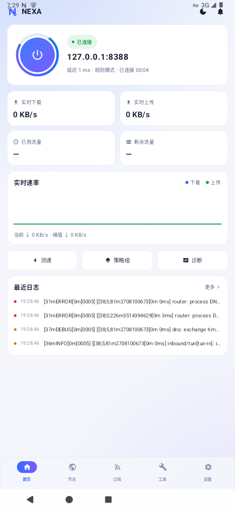

**首页 · 夜间主题**(顶栏月亮 / 太阳一键切换)

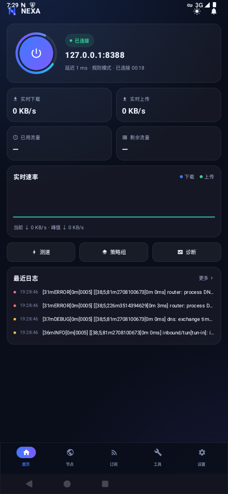

**节点管理 与 测速延迟质量条**(条越长、颜色越绿 = 节点越快,与右侧延迟徽章同色)

  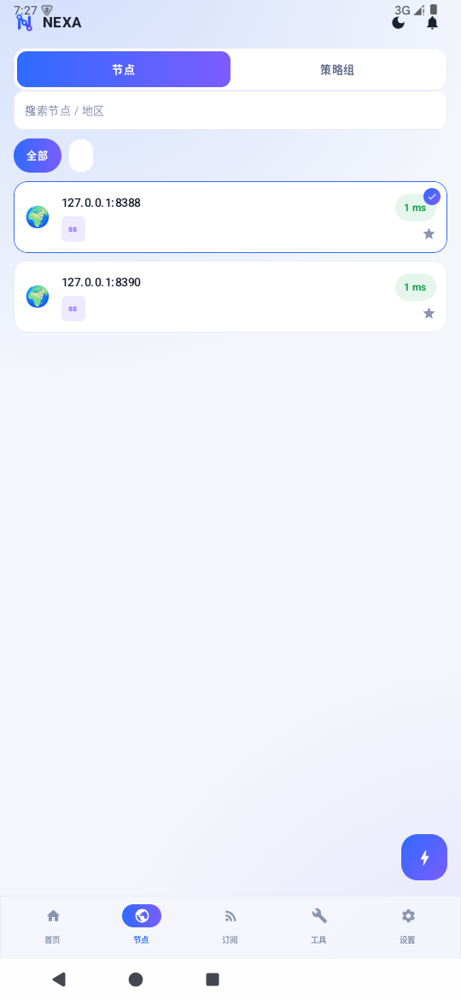
  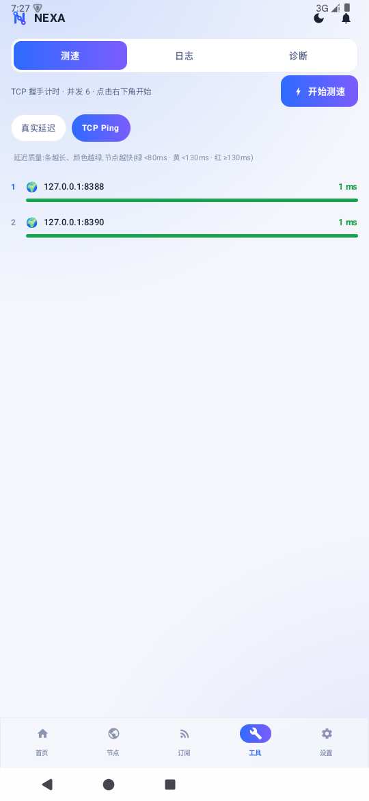

**导入中心**(订阅 / 分享链接 / 相册识别 / 相机扫码)

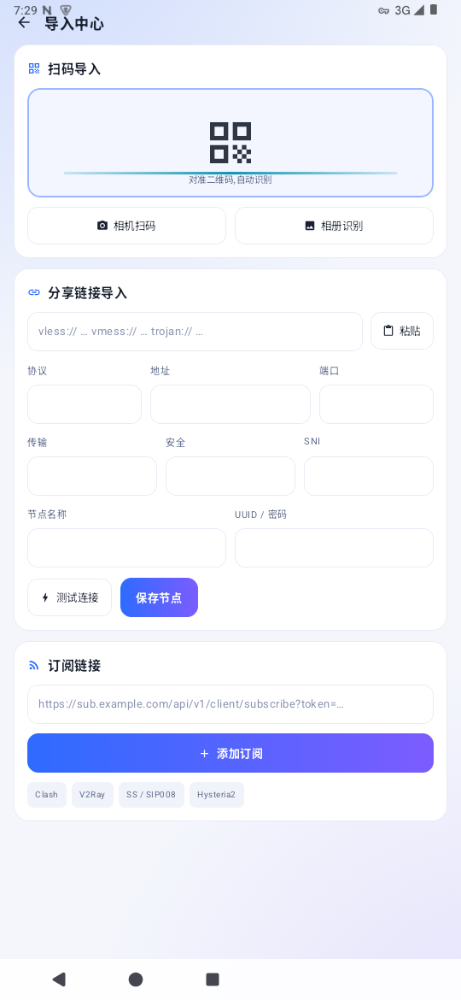

**设置中心**(夜间主题)

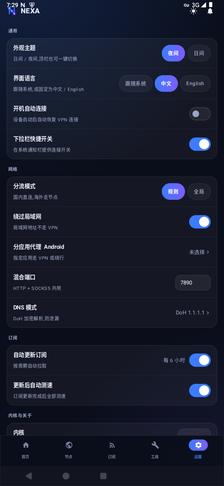

### 📥 下载与更新

- 前往 [**Releases**](../../releases) 下载最新 `NEXA-Android-arm64.apk`(主流 64 位机型)或 `NEXA-Android-universal.apk`(其他架构),直接安装即可
- **应用内自动更新**:「设置 → 检查更新」一键检查 → 下载 → 覆盖安装;启动时也会静默检查一次
- **国内可用**:清单与安装包均走中转镜像级联(gh-proxy 系 5 源 + jsDelivr 兜底),并对更新信息做 ed25519 签名校验、对安装包做 SHA256 校验
- 版号线独立演进:Android 3.x 的更新与 Windows 2.x / macOS 1.x 的更新互不影响

### 🚀 Android 功能特性

| 模块 | 说明 |
| --- | --- |
| 🔌 VpnService 全局接管 | sing-box 1.14 进程内运行,免 root,双栈防泄漏,自身流量防环路 |
| 🌏 规则 / 全局分流 | 内置国内规则集(镜像回退 + SHA256 锚定),连接中热切换分流模式 |
| 📶 订阅管理 | Clash / V2Ray / SS 格式,流量与到期显示,WorkManager 周期自动更新 + 更新后自动测速 |
| 🔍 多种导入 | 订阅链接、分享链接解析、相册识别、相机扫码(CameraX + ZXing) |
| 🚀 节点测速 | TCP 握手 / HTTP 真实延迟(经内核 204 探测),延迟质量条,连接中热切换节点 |
| 🧩 系统集成 | 开机自启、下拉栏快捷开关(QS Tile)、分应用代理(排除 / 包含名单)、实时速率曲线 |
| 🌗 双主题 · 双语 | 极光夜 / 日间即时切换;界面中文 / English 可固定 |
| 🔄 应用自更新 | GitHub Release + 中转镜像级联 + ed25519 验签 + SHA256 校验 + 系统安装器覆盖升级 |

### ❓ Android 常见问题

**Q: 安装更新时提示"安装未知应用"?**
系统要求:设置中允许 NEXA「来自此来源安装」一次即可,之后的应用内更新不再询问。

**Q: 检查更新失败?**
更新走中转镜像级联,个别镜像临时不可用会自动切换下一个;全部失败时多为网络受限,稍后重试或直接到 [Releases](../../releases) 下载。

---

## 📄 免责声明

本软件仅供网络技术研究与学习使用,请遵守所在地区法律法规。使用本软件产生的一切后果由使用者自行承担。

---

© 2026 NEXA · Go + Wails v2 · sing-box

